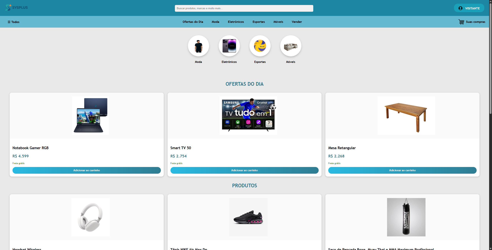

# Sysplus
 
Simulação de um marketplace feito apenas com **HTML, CSS e JavaScript puro**, sem back-end e sem frameworks. O projeto cobre o caminho completo de uma compra: navegar pelos produtos, filtrar por categoria, montar o carrinho, cadastrar-se, informar o endereço, escolher a forma de pagamento e confirmar o pedido.
 
> Projeto acadêmico e de estudo. Nenhum pagamento é processado e nenhum dado sai do navegador.
 
**Site no ar:** [abrir](https://lucasfbsdev8.github.io/Sysplus/)
 

 
## O que o projeto faz
 
- **Vitrine de produtos** com seção de ofertas do dia, 15 produtos e cards gerados por JavaScript a partir de uma lista (`produtos.js`)
- **Filtro por categoria** (Moda, Eletrônicos, Móveis e Esportes), com normalização de acentos, e um produto pode estar em mais de uma categoria
- **Busca em tempo real** pelo nome do produto
- **Página de produto** com preço original e atual, entrega, descrição e avaliação em estrelas (carregada pelo `id` na URL)
- **Carrinho** com alteração de quantidade, remoção, total calculado e contador no cabeçalho
- **Cadastro em duas etapas** (dados básicos e perfil, com CEP e preferências) e **login** com validação dos campos
- **Checkout em três passos:** carrinho, endereço de entrega e pagamento
- **Quatro formas de pagamento:**
  - **PIX**, com código "copia e cola" e QR Code gerado no navegador
  - **Boleto**, com máscara e validação de CPF
  - **Cartão de débito**, com máscaras de número e validade
  - **Cartão de crédito**, com escolha de parcelas (2, 4, 10 ou 12x, com juros de exemplo)
- Mensagens de aviso (toast) e botão de voltar ao topo
## Tecnologias
 
| Tecnologia | Uso |
|---|---|
| HTML5 e CSS3 | Estrutura e estilo das páginas |
| JavaScript (ES6) | Renderização dos cards, carrinho, validações e fluxo de compra |
| `localStorage` | Usuários cadastrados, sessão de login e carrinho |
| `sessionStorage` | Dados temporários do cadastro, do endereço e da forma de pagamento |
| [QRCode.js](https://github.com/davidshimjs/qrcodejs) | QR Code do PIX (carregado por CDN) |
 
## Estrutura
 
```
index.html            vitrine, filtros e busca
produtos.html         página de um produto (?id=)
carrinho.html         carrinho de compras
login.html            login
signup.html           cadastro, etapa 1
signup2.html          cadastro, etapa 2
perfil.html           perfil do usuário
endereco.html         endereço de entrega
formapagamento.html   escolha da forma de pagamento
pagamento.html        tela de pagamento
css/style.css         estilos
js/
  produtos.js         lista de produtos e estrelas de avaliação
  carrinho.js         carrinho, contador e toast
  formaPagamento.js   guarda a forma escolhida
  pagamento.js        PIX, boleto, cartões e finalização
img/                  logos, ícones e fotos dos produtos
```
 
## Como rodar
 
Não precisa instalar nada.
 
1. Clone o repositório:
```bash
git clone https://github.com/lucasfbsdev8/Sysplus
```
2. Abra a pasta no VS Code.
3. Clique com o botão direito em `index.html` e escolha **Open with Live Server**.
Também funciona abrindo o `index.html` direto no navegador, mas o Live Server é mais seguro, porque o `localStorage` é separado por endereço.
 
## Como usar
 
1. Crie uma conta em **Cadastre-se** (use dados fictícios) ou faça login.
2. Adicione produtos ao carrinho pela vitrine ou pela página do produto.
3. Em **Finalizar Compra**, informe o endereço e escolha a forma de pagamento.
4. Confirme o pedido. O carrinho é esvaziado e você volta para a página inicial.
Para começar do zero, limpe os dados do site no navegador (F12 → Application → Local Storage → Clear).
 
## Limitações conhecidas
 
Este é um projeto didático, então algumas partes são simulações de propósito:
 
- **Não existe servidor nem banco de dados.** Usuários e carrinho ficam no navegador de quem usa, e as senhas são salvas em texto puro no `localStorage`. Isso **não deve ser usado em um sistema real**.
- Os pagamentos são fictícios. O código PIX é de exemplo e os dados do cartão não são enviados a lugar nenhum.
- O frete é sempre "grátis" e as parcelas usam um juros fixo de exemplo.
## Próximos passos
 
- [ ] Back-end com banco de dados para cadastro, login com senha criptografada e pedidos
- [ ] Histórico de pedidos no perfil
- [ ] Busca funcionando em todas as páginas, e não só na inicial
- [ ] Layout responsivo para celular
## Autores
 
- [Lucas Fernandes](https://github.com/lucasfbsdev8)
- *(acrescente aqui os colegas do grupo, se houver)*
Projeto desenvolvido no curso de Sistemas de Informação.